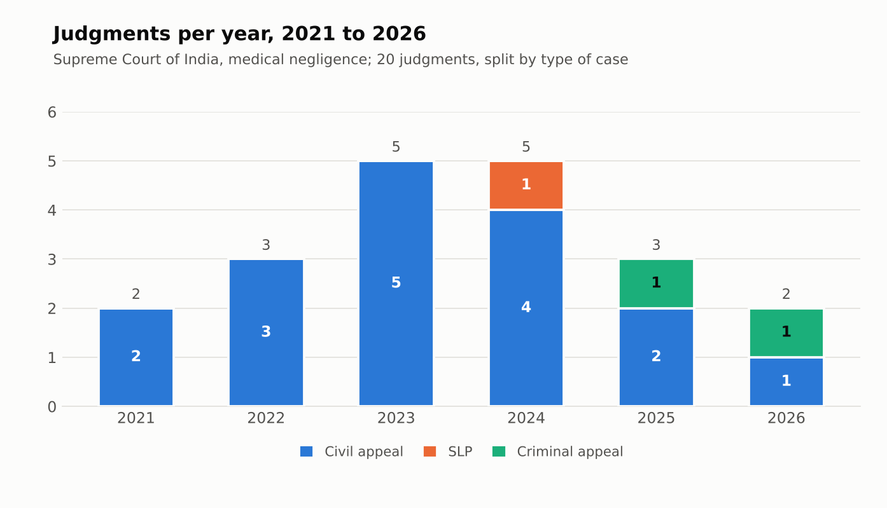
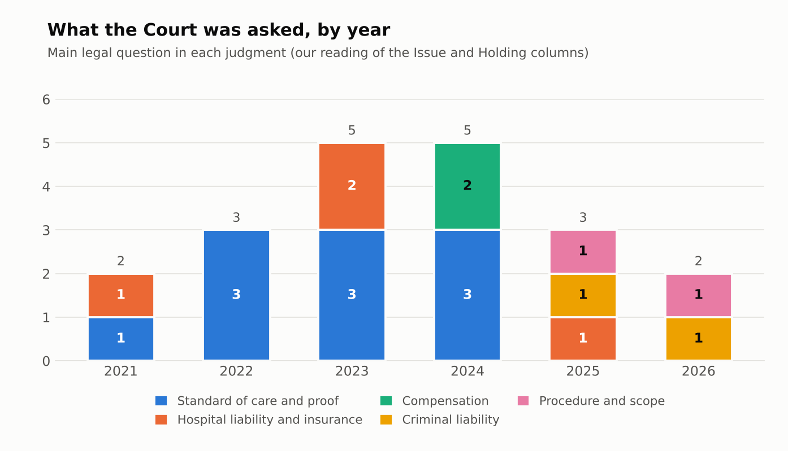
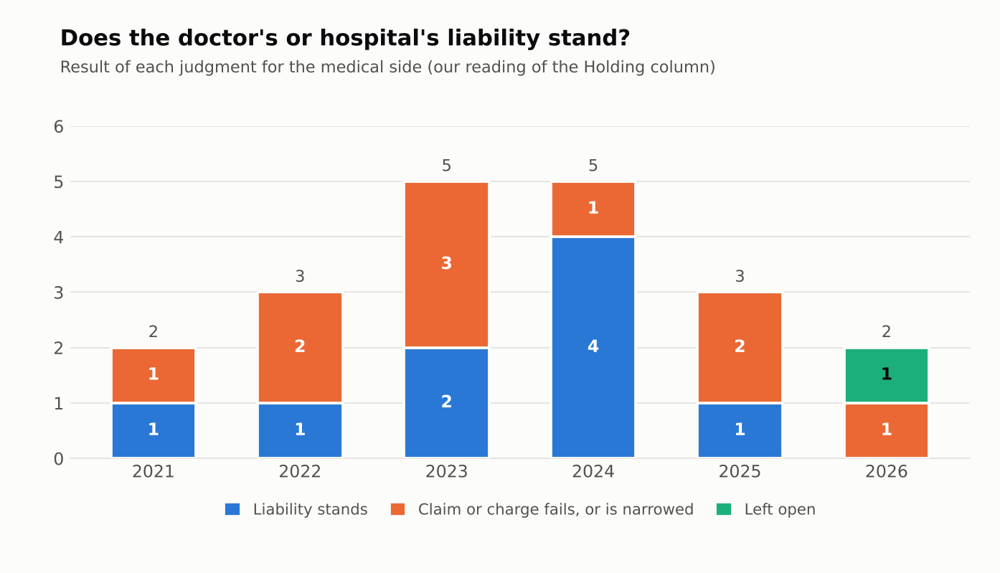
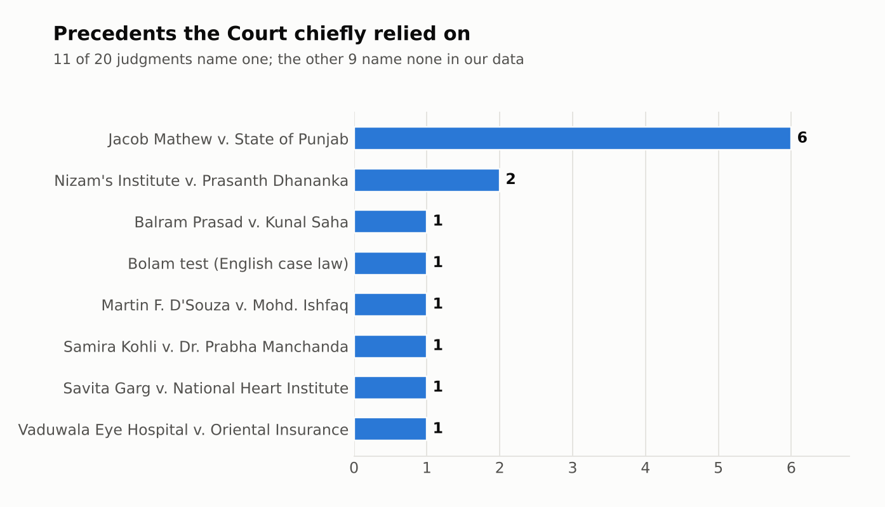
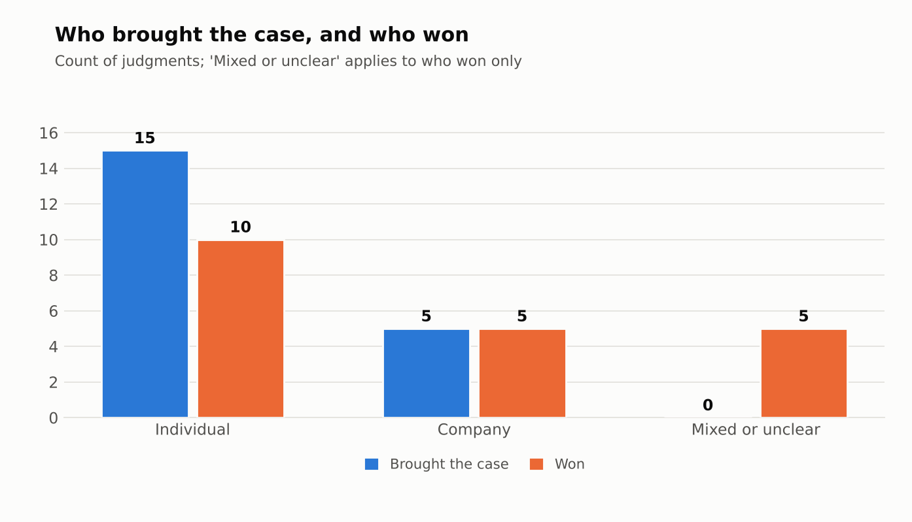

# Medical negligence of doctors and hospitals in the Supreme Court of India, 2021 to 2026

## Team

Team name: Duty of Care

- Pranavi Kollu, Section B
- Pragna Mattela, Section D
- Jyotsna Reddy, Section D

## Topic

This project studies how the Supreme Court of India decides claims that doctors and hospitals were negligent, in both consumer and criminal cases. It interests us because it sits where law meets everyday trust in a doctor, and because the Court must decide how far a bad medical outcome says anything about the quality of care. We wanted to see whether the Court's approach changed between 2021 and 2026.

## How we found the judgments

We did not use a paid database. We searched the open web, mainly Supreme Court of India PDFs and legal news and law-report sites such as LiveLaw, Verdictum, SCC Online Blog and Indian Kanoon. Our search terms included "Supreme Court medical negligence judgment", "NCDRC doctor hospital negligence", "hospital vicarious liability", "professional indemnity insurance hospital" and "section 304A doctor". Each search returned roughly 10 to 20 links, many of them repeats of the same judgments. We kept a judgment only if the Supreme Court decided it between 01-09-2021 and 31-08-2026, it concerned the negligence of a doctor or hospital, and we could find its citation or case number and a report of its holding. That left 20 judgments, which we recorded one row each in the Data sheet.

## What the data shows

The 20 judgments fall mostly in 2023 and 2024, with five each. 2021 is a part-year because our window starts in September. Seventeen are civil appeals, one is a special leave petition and two are criminal appeals. What surprised us is that both criminal appeals come from 2025 and 2026.

We grouped each judgment by its main legal question. Up to 2024, ten of the 15 judgments are about the standard of care and what must be proved. In 2025 and 2026 none is: the five judgments deal with criminal liability, procedure (pleadings, legal heirs) and hospital liability. We did not expect a change this sharp, though the sample is small.

Liability of the doctor or hospital stood in nine judgments and failed or was narrowed in ten, with one left open. Only 2024 leans towards liability standing (four of five). We expected a clear drift towards doctors or towards patients and found none. The Court also set aside the NCDRC's order in eight of the 18 civil and consumer judgments and upheld it in seven.

Jacob Mathew v. State of Punjab is the chief precedent in six judgments, at least one in every year from 2021 to 2026, in civil and criminal cases alike. That steadiness did not surprise us. What did is that nine judgments name no precedent in our data, so the real count may be higher.

Individuals brought 15 cases and companies five. Individuals won ten, companies five, and five had no clear winner. "Individual" covers both patients and doctors, so this chart cannot show who fares better; chart 3 is the better guide. The five unclear results surprised us.

## Limits

Twenty judgments found by web search are not a complete list of the Court's medical negligence decisions. A reader should not conclude how often the Court rules for doctors or patients, or that its doctrine changed, from counts of two to five judgments a year. The groupings behind charts 2 and 3 are our own reading of one-line summaries, and another reader might code some judgments differently.

## AI-use disclosure

We used Claude, an AI assistant made by Anthropic, to convert citations to Supreme Court citations, add two judgments (P.N. Gupta and D.C. Malviya), check dates, benches and case numbers, group the judgments, draw the charts, build the web page and draft this README. Its facts were cross-checked against law-report and news sites. We have not yet compared every entry with the official Supreme Court copy, so entries without a sci.gov.in link in the Source column are the least verified and should be treated as unconfirmed.

This project is published using GitHub Pages.
